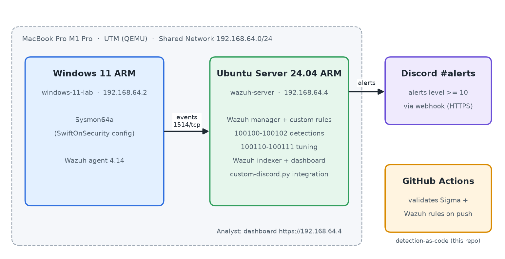
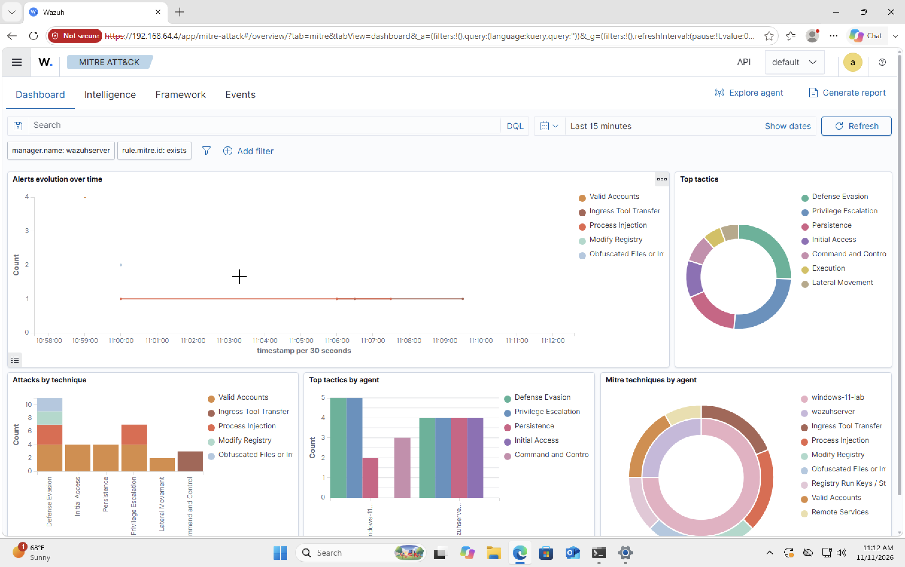
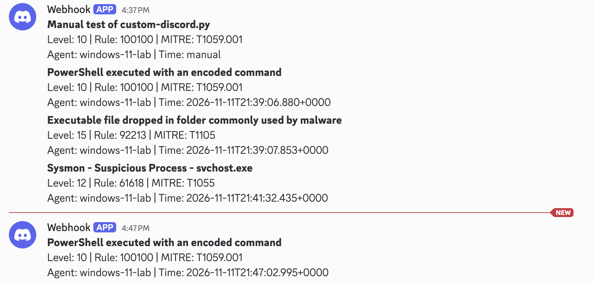
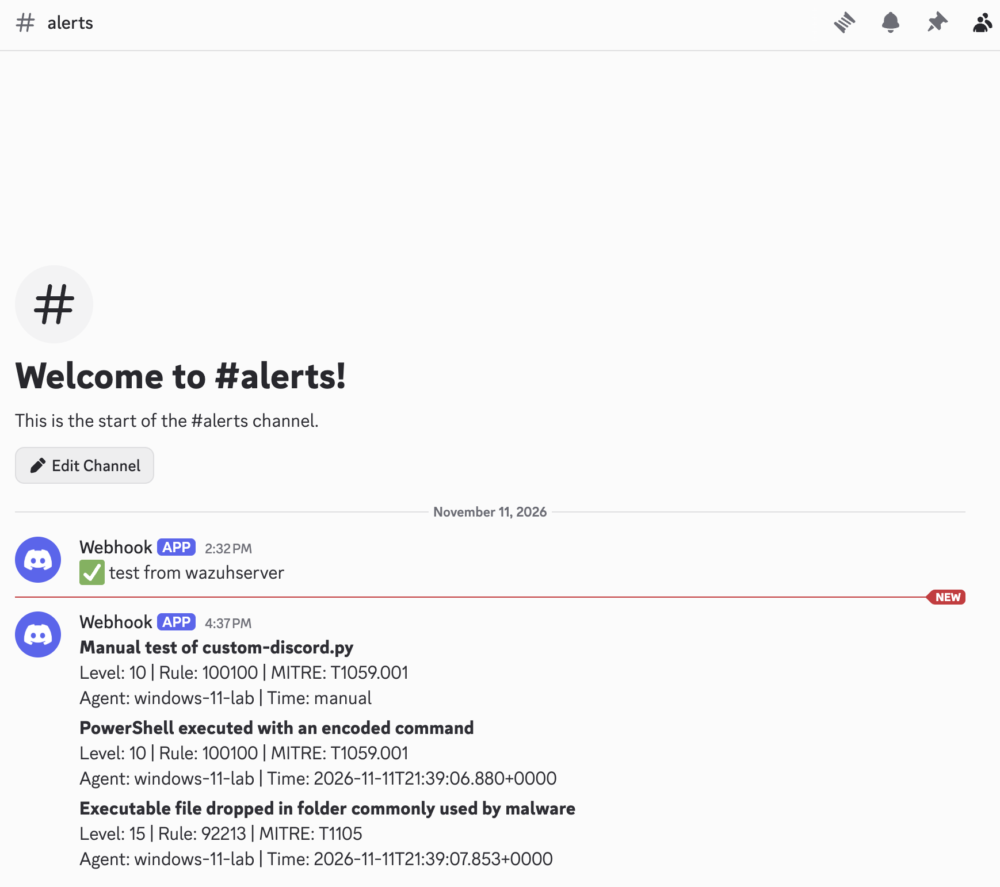

# Home SOC Lab — Threat Detection & Automated Alerting with Wazuh

A home Security Operations Center built on an Apple Silicon MacBook: a Windows 11 endpoint
instrumented with **Sysmon**, a **Wazuh SIEM** on Ubuntu Server, custom **MITRE ATT&CK**-mapped
detections managed as code, and automated **Discord** alerting.

## Architecture

| Component | Role | Details |
|---|---|---|
| Windows 11 ARM (UTM / QEMU) | Monitored endpoint | Sysmon (SwiftOnSecurity config) + Wazuh agent |
| Ubuntu Server 24.04 ARM (UTM / QEMU) | SIEM | Wazuh 4.14 — manager, indexer, dashboard |
| Discord `#alerts` | Notifications | Custom Wazuh integration, alerts ≥ level 10 |
| GitHub Actions | Detection-as-code | Validates Sigma + Wazuh rules on every push |

Network: UTM Shared Network `192.168.64.0/24` (isolated NAT on the host).

## Detections

| # | Detection | MITRE ATT&CK | Log source | Wazuh rule | Sigma rule | Proof |
|---|---|---|---|---|---|---|
| 01 | PowerShell encoded command | T1059.001 | Sysmon EID 1 | 100100 | [sigma](detections/sigma/01-powershell-encoded-command.yml) | [proof](screenshots/07-detection-01-powershell.png) |
| 02 | Registry Run-key persistence | T1547.001 | Sysmon EID 13 | 100101 | [sigma](detections/sigma/02-registry-run-key.yml) | [proof](screenshots/08-detection-02-runkey.png) |
| 03 | Certutil used to download a file | T1105 | Sysmon EID 1 | 100102 | [sigma](detections/sigma/03-certutil-download.yml) | [proof](screenshots/09-detection-03-certutil.png) |

Full write-ups (test performed, log evidence, false positives, tuning): [docs/detections.md](docs/detections.md)

## Alert triage & tuning

Two noisy **built-in** Wazuh rules were investigated, proven benign, and tuned narrowly (details in [docs/detections.md](docs/detections.md#alert-triage-false-positives)):

| # | Alert | Root cause | Tuning |
|---|---|---|---|
| FP-01 | 92213 Executable dropped in Temp (lvl 15) | PowerShell's own `__PSScriptPolicyTest_*.ps1` execution-policy probe | Rule 100110 silences only that file from System32 `powershell.exe` |
| FP-02 | 61618 Suspicious svchost.exe (lvl 12) | `services.exe` starts before Sysmon, so the parent shows as unknown | Rule 100111 downgrades to level 5 (kept in SIEM, off Discord) |

## Automated alerting

High-severity alerts are pushed to Discord by [`integrations/custom-discord.py`](integrations/custom-discord.py).
The webhook URL lives only in the server's `ossec.conf` and is never committed.

## Skills demonstrated

SIEM (Wazuh) · Sysmon · Windows event logging · Sigma · MITRE ATT&CK · Detection engineering ·
Python · GitHub Actions CI · Linux administration · Virtualization (UTM/QEMU on Apple Silicon)

## Build log & lessons learned

- Ran the whole lab on Apple Silicon (ARM64) — chose ARM builds of Windows 11, Ubuntu, Sysmon (`Sysmon64a.exe`) and Wazuh.
- Diagnosed a VM network split (Apple Virtualization vs QEMU backends land on different NAT subnets) and moved both VMs to QEMU.
- Fixed a black-screen boot by switching the UTM display card from `virtio-gpu-gl-pci` to `virtio-gpu-pci` with OpenGL off.
- Wazuh's generic `4.x` installer URL started returning *Access Denied*; pinned the versioned `4.14` URL and added `curl -f` so a failed download stops instead of executing an error page.
- Rotated a Discord webhook secret after it was exposed in plain text.
- Run-key rule (100101) silently missed at first. Debugging showed two causes: Wazuh's built-in rule 92302 claimed the event first (fixed by chaining `if_sid` off it), and Wazuh stores Windows paths with doubled backslashes (fixed the regex to `\\+`). Re-tested until it fired.
- Certutil download test was blocked outright by Defender (no process, so no Sysmon event). Validated rule 100102 with a benign `certutil -urlcache *` instead, a reminder that prevention and detection are separate layers.
- Discord alerts silently never arrived even though `curl` to the webhook worked. `ossec.log` showed `CERTIFICATE_VERIFY_FAILED`: Wazuh's bundled Python has no CA store. Fixed by loading Ubuntu's system CA bundle in the integration script (kept TLS verification on rather than disabling it).

## Setup

See [docs/setup.md](docs/setup.md).
