# Detection write-ups

Every test below was run on my own isolated lab VM (`windows-11-lab`).

<!-- Template for each detection:
## NN – Name (Txxxx)
- **Test:** exact command run on windows-11-lab
- **Log source:** e.g. Sysmon Event ID 1
- **Rules:** Wazuh 1001xx · sigma/NN-name.yml
- **Result:** fired / did not fire / tuned
- **False positives:** what legit activity could trigger it
- **Evidence:** 
-->

## 01 – PowerShell encoded command (T1059.001)
- **Test:** `powershell -enc VwByAGkAdABlAC0ATwB1AHQAcAB1AHQAIAAiAGgAaQAiAA==` (prints "hi")
- **Log source:** Sysmon Event ID 1 (process create)
- **Rules:** Wazuh 100100 · [sigma](../detections/sigma/01-powershell-encoded-command.yml)
- **Result:** fired (rule 100100, level 10) on first test
- **False positives:** management tools that pass encoded scripts
- **Evidence:** 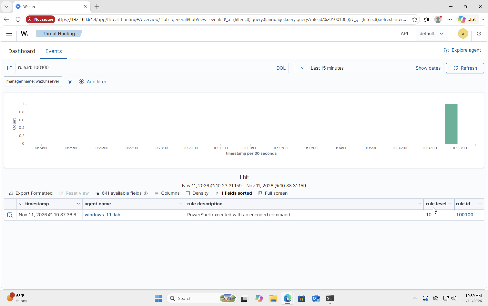

## 02 – Registry Run-key persistence (T1547.001)
- **Test:** `reg add HKCU\Software\Microsoft\Windows\CurrentVersion\Run /v LabRun /d notepad.exe /f`
- **Log source:** Sysmon Event ID 13 (registry value set)
- **Rules:** Wazuh 100101 · [sigma](../detections/sigma/02-registry-run-key.yml)
- **Result:** fired (rule 100101, level 10) after tuning: chained off built-in 92302 and fixed the regex for Wazuh's doubled backslashes
- **False positives:** installers/updaters registering autostart entries
- **Evidence:** 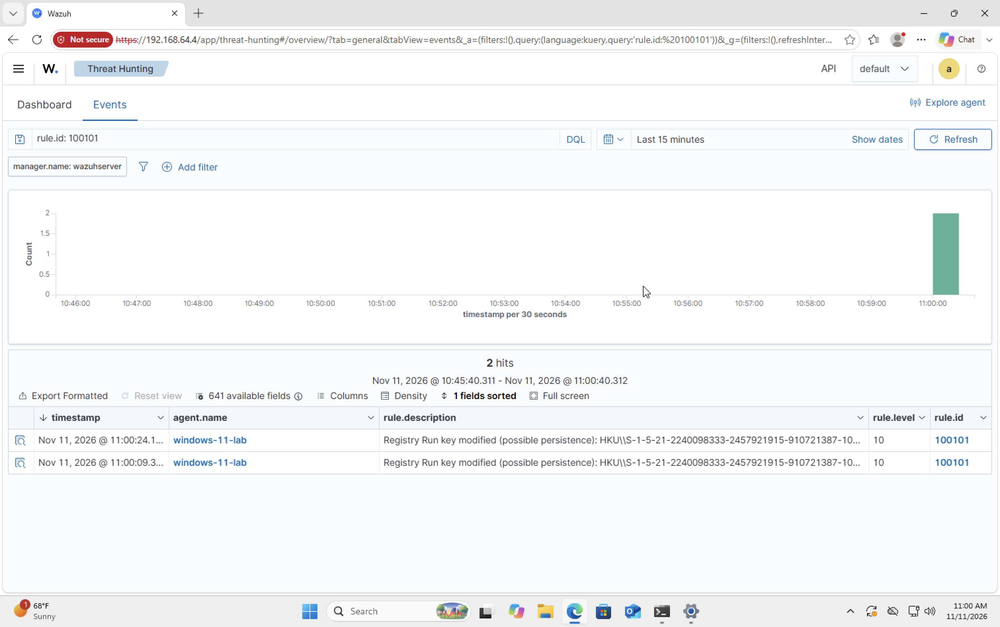 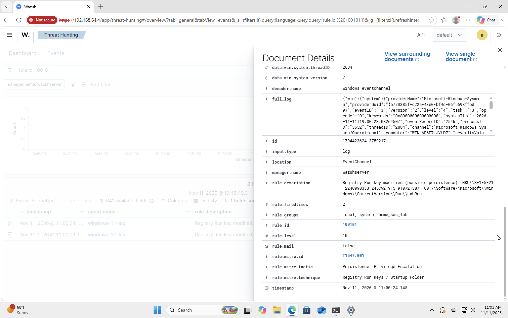 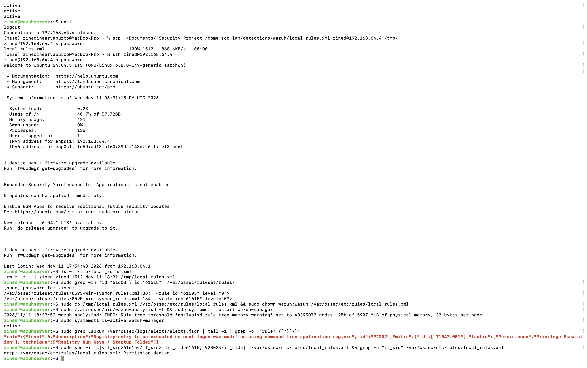
- **Cleanup:** `reg delete HKCU\Software\Microsoft\Windows\CurrentVersion\Run /v LabRun /f`

## 03 – Certutil download (T1105)
- **Test:** `certutil -urlcache -f https://example.com C:\Users\Public\test.txt`
- **Log source:** Sysmon Event ID 1
- **Rules:** Wazuh 100102 · [sigma](../detections/sigma/03-certutil-download.yml)
- **Result:** the real download (`certutil -urlcache -f <url> <file>`) was **blocked by Microsoft Defender** before the process started ("Access is denied"), so no Sysmon event existed to detect: prevention beat detection. Re-tested with the harmless `certutil -urlcache *` (lists the cache, same `urlcache` command-line pattern): rule 100102 fired at level 12.
- **False positives:** rare admin use
- **Evidence:** 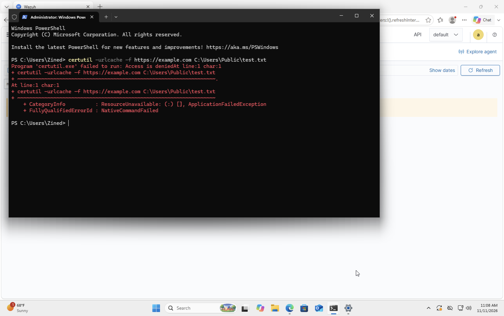 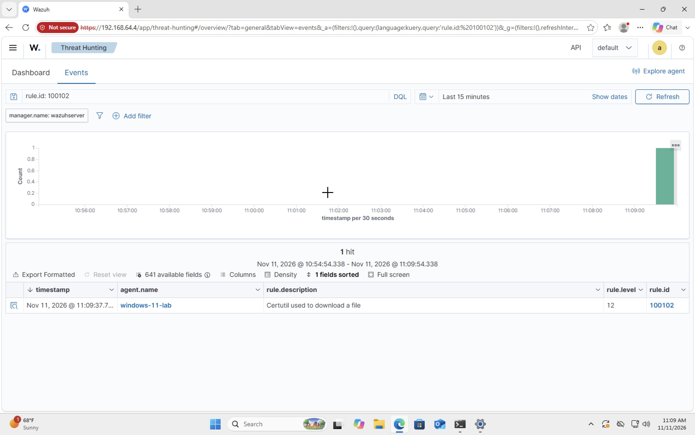 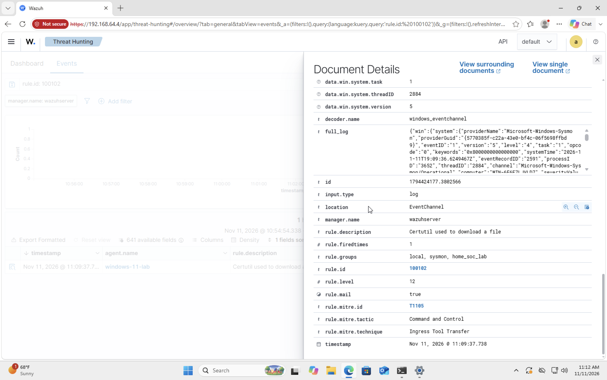

# Alert triage (false positives)

## FP-01 – Built-in rule 92213 "Executable file dropped in folder commonly used by malware" (level 15, T1105)
- **Seen:** 9 hits in 24 h on `windows-11-lab`, each within ~1 s of one of my PowerShell tests.
- **Evidence:** Sysmon Event ID 11 (file create). `image` = `C:\Windows\System32\WindowsPowerShell\v1.0\powershell.exe`, `targetFilename` = `C:\Users\<user>\AppData\Local\Temp\__PSScriptPolicyTest_<random>.ps1`.
- **Analysis:** PowerShell writes and deletes a `__PSScriptPolicyTest_*.ps1` file in `%TEMP%` on every start to check the execution policy (AppLocker/WDAC probe). A script landing in Temp matches the rule's malware heuristic, but the parent is signed `powershell.exe`, the file name is the fixed Microsoft pattern, and the timing lines up 1:1 with my own test launches.
- **Verdict:** benign / false positive. Any Temp file *not* matching that exact pattern from PowerShell would still deserve a look.
- **Tuning:** rule 100110 (level 0) chains off 92213 and silences it only when the creator is `System32\...\powershell.exe` **and** the file matches `__PSScriptPolicyTest_*.ps1` in Temp. A fake `powershell.exe` elsewhere, or any other script dropped in Temp, still alerts.
- **Verified:** after deploying 100110, the same PowerShell test raised only rule 100100; the level-15 92213 alert no longer fired.
- **Evidence:** 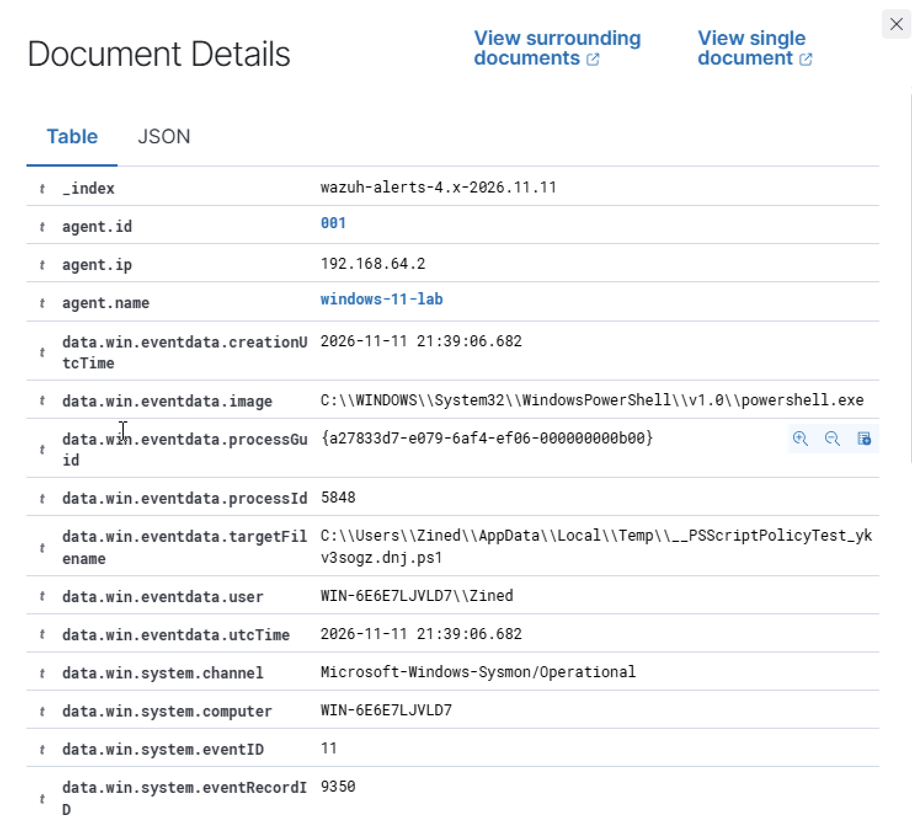 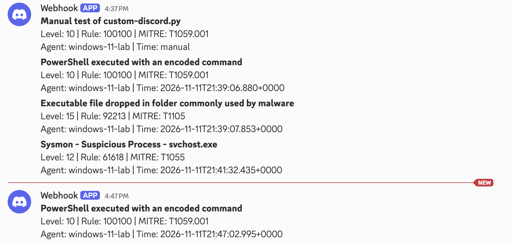

## FP-02 – Built-in rule 61618 "Sysmon - Suspicious Process - svchost.exe" (level 12, T1055)
- **Seen:** 26 hits in 24 h on `windows-11-lab`.
- **Why the rule exists:** a real `svchost.exe` is always launched by `services.exe`; malware often names itself svchost to blend in, so any other parent is suspicious.
- **Evidence (Sysmon Event ID 1):**
  - `image` = `C:\Windows\System32\svchost.exe`, `commandLine` = `svchost.exe -k GPSvcGroup` (Group Policy client service)
  - `user` = `NT AUTHORITY\SYSTEM`, integrity System; company/product = Microsoft Windows; `originalFileName` = `svchost.exe`
  - `parentProcessGuid` = `{00000000-…}` (all zeros), `parentImage` empty, `parentProcessId` = 768
- **Pivot:** on the host, `Get-Process -Id 768` → `services`. The parent *is* `services.exe`.
- **Analysis:** `services.exe` starts during boot, before the Sysmon driver loads, so Sysmon has no GUID or image path for it. The parent field is blank, it doesn't match `services.exe`, and the rule fires on missing data rather than malicious behaviour.
- **Verdict:** benign / false positive caused by a telemetry gap.
- **Tuning:** rule 100111 **downgrades** (does not silence) 61618 to level 5 only when the image is exactly `C:\Windows\System32\svchost.exe`, the user is `SYSTEM`, and the parent GUID is all zeros. It stays searchable in the dashboard but no longer pages Discord. A svchost outside System32, running as a normal user, or with a resolved non-services parent still alerts at level 12.
- **Evidence:** 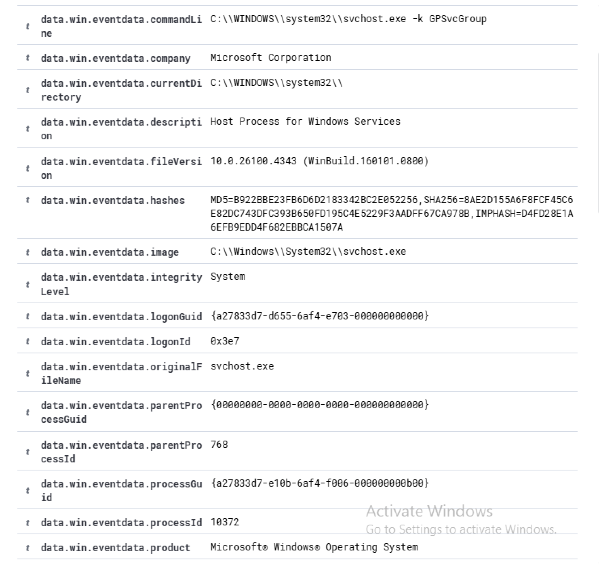 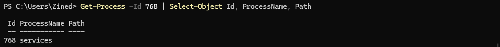
